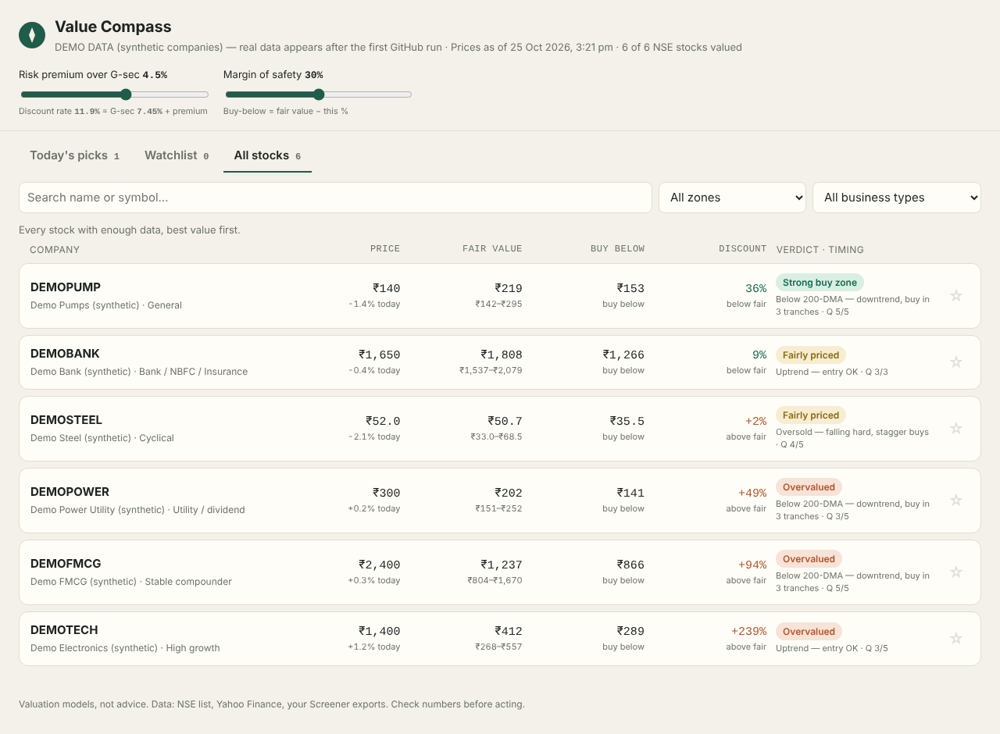
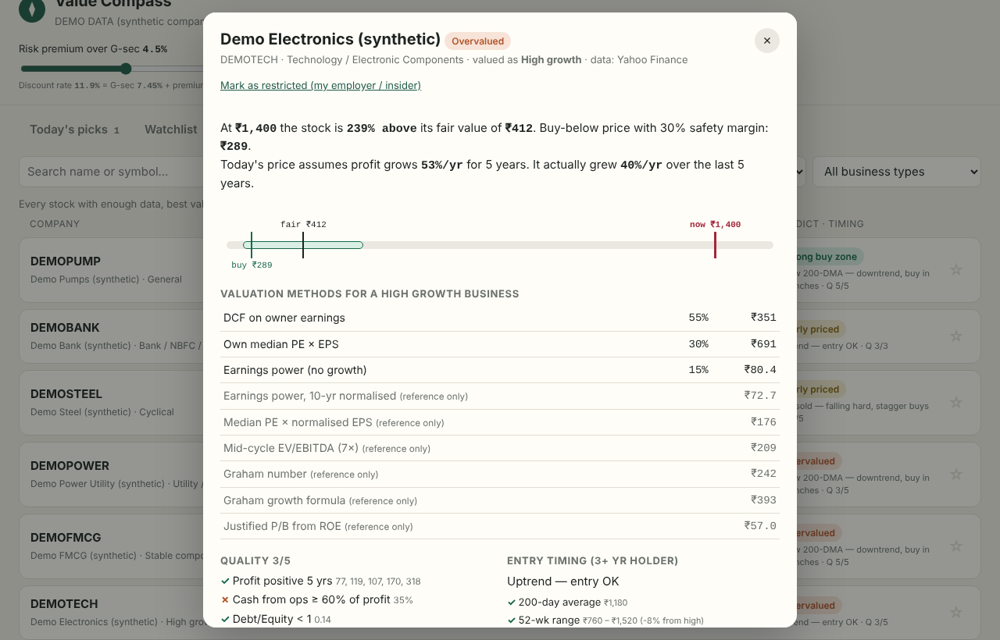
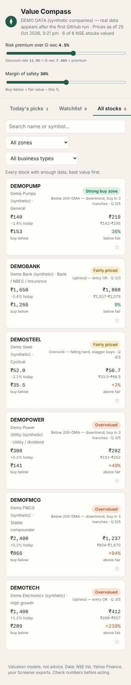

# Value Compass — daily intrinsic value for every NSE stock

**Open one page each evening and see which Indian stocks are trading below their fair value — with no manual input.**

A free GitHub Action runs every weekday after market close. It values ~2,000 NSE-listed companies with the methods that suit each business type, compares them with that day's closing price, and publishes a dashboard you can open on your phone.

**Live dashboard:** https://kartikeyanmurugan.github.io/value-investing/



> ⚠️ Educational tool. These are valuation models built on public data that may be incomplete or wrong — not investment advice. Always verify numbers and do your own research.

---

## Why this exists

Most intrinsic-value spreadsheets have three problems:

1. **You must download and fill them for each stock**, so you only check a few companies, rarely.
2. **One formula is applied to every industry.** A bank, a steel maker and an FMCG company cannot be valued the same way.
3. **They give a single number**, with no sense of how sure it is or what the current price is betting on.

Value Compass fixes all three: fully automatic, sector-aware, and it shows a value *range*, a buy-below price, and the growth the market is already pricing in.

## What you see

| Tab | Shows |
|---|---|
| **Today's picks** | Quality companies trading at least your margin of safety (default 30%) below fair value |
| **Watchlist** | Stocks you star (saved in your browser) |
| **All stocks** | Everything, cheapest first, filterable by verdict and business type |

Tap any stock for the full breakdown:



- **Verdict:** Strong buy zone · Buy zone · Fairly priced · Overvalued · Priced for perfection
- **Fair value range** and **buy-below price**, drawn against today's price
- **Each valuation method**, its weight, and its result
- **Implied growth:** the yearly profit growth today's price assumes, vs what the company actually achieved
- **Quality checks:** 5 years of profit, cash conversion, debt, ROCE, other income
- **Entry timing** for long-term buyers: 200-day average, 52-week range, RSI
- **Sliders:** risk premium, margin of safety, and a per-stock growth assumption

Works on mobile:



## How a stock is valued

### 1. Detect the business type

| Type | Detected by | Methods blended |
|---|---|---|
| Bank / NBFC / insurance | Sector, or very high debt-to-equity with interest as core revenue | Justified P/B from ROE · own median P/B · own median PE |
| Cyclical | Sector (metals, cement, energy, chemicals, realty…) or frequent profit drops | 10-yr normalised earnings power · mid-cycle EV/EBITDA · median PE × normalised EPS |
| Utility | Sector | Dividend discount · DCF · earnings power |
| High growth | 5-yr sales growth > 18% | DCF on owner earnings · own median PE · earnings-power floor |
| Stable compounder | High ROCE, steady profits | DCF with a 10-year growth runway · own median PE · earnings-power floor |
| General | Everything else | DCF · own median PE · Graham formula · earnings power |
| Loss-making | Negative recent or 5-yr profit | Not valued — flagged |

Weights are in [`site/engine.js`](site/engine.js) (`WEIGHTS`) and easy to change.

### 2. Discount rate

**Discount rate = India 10-year G-sec yield (fetched automatically) + an equity risk premium (slider, default 4.5%).**

It never goes below the G-sec yield. Using the repo rate would be wrong: it is an overnight policy rate, and would imply a fair PE near 18 for every stock. Adding inflation on top would also be wrong, because the bond yield already includes it.

### 3. Fair value range and verdict

The methods are blended into a fair value. The spread between methods sets a low–high range. Then:

| Verdict | When |
|---|---|
| 🟢 Strong buy zone | Price below the low end of the range and the buy-below price |
| 🟢 Buy zone | Price at least the margin of safety below fair value |
| 🟡 Fairly priced | Price inside the range |
| 🟠 Overvalued | Price above the range |
| 🔴 Priced for perfection | The growth the price implies is more than 2× what the company has actually delivered |

### 4. Methods in brief

- **Earnings power value (EPV):** 5-yr average core profit ÷ discount rate, plus surplus cash and investments, minus debt and any working-capital shortfall. The value with zero growth.
- **DCF on owner earnings:** profit grows at the assumed rate, then fades to long-run growth. Cash flow = earnings × (1 − growth ÷ ROCE), because growth needs reinvestment, and less so for high-ROCE businesses.
- **Reverse DCF:** solves for the growth that justifies today's price.
- **Own median PE / P/B:** the stock's own 10-year history, capped so a past bubble isn't treated as fair.
- **Justified P/B:** (ROE − g) ÷ (r − g) × book value, for lenders.
- **Mid-cycle EV/EBITDA:** average margin × current sales × 7, for cyclicals.
- **Dividend discount:** for steady dividend payers.
- **Graham number and Graham growth formula:** shown as reference.

**Core profit** excludes after-tax other income, since cash and investments are already added separately. Otherwise that income would be counted twice.

## Data sources

| Data | Source | Refresh |
|---|---|---|
| List of NSE stocks | NSE `EQUITY_L.csv` | Daily |
| Prices, 200-DMA, 52-week range, RSI | Yahoo Finance (`yfinance`) | Daily |
| Financial statements | Yahoo Finance (`yfinance`) | Rolling, ~250 companies a day (every company about every 8 trading days) |
| 10-yr G-sec yield | OECD series via FRED | Monthly |
| Optional 10-year history | Your Screener.in exports in `screener_exports/` | When you add them |

Yahoo often has only ~4 years of Indian financials, and some companies have gaps. For stocks you care about, you can add a Screener.in export (see below) for 10-year history.

## Use your own copy

1. **Fork** this repo.
2. In your fork: **Settings → Pages → Source: GitHub Actions**.
3. **Actions** tab → enable workflows (GitHub disables scheduled workflows on forks by default).
4. **Actions → Daily valuation → Run workflow**, tick **full** once. This fetches all companies (1–2 hours).
5. Open `https://<your-username>.github.io/value-investing/`.

From then on it updates every weekday at 7 PM IST. It costs nothing: public repos get unlimited free Actions minutes.

### Adding 10-year data for your watchlist (optional)

On Screener.in, open a company → **Export to Excel**. Put the file in `screener_exports/` and push. The company is matched to its NSE symbol by name, and Screener's fundamentals replace Yahoo's for it. Prices still update daily.

**In a public repo these files are public.** Only add exports you're comfortable sharing, and respect Screener.in's terms of use.

### Personal settings

- **Stocks you must not trade** (for example your employer's, under insider-trading rules): open the stock → **Mark as restricted**. This is saved only in your browser and never committed.
- Shared defaults are in [`site/config.js`](site/config.js).

## Project structure

```
site/                 the dashboard (static HTML/JS, no build step)
  engine.js           all valuation logic — used by the browser and by the tests
  app.js, style.css   UI
  config.js           shared settings
  data/stocks.json    generated daily (demo data until the first run)
pipeline/
  fetch.py            daily job: NSE list → Yahoo → Screener exports → stocks.json
  screener_export.py  parser for Screener.in "Export to Excel" files
screener_exports/     optional Screener.in exports
data/                 cached fundamentals (generated)
tests/                offline tests with synthetic companies
.github/workflows/    daily schedule + GitHub Pages deploy
```

## Run locally

```bash
pip install -r requirements.txt
python pipeline/fetch.py --limit 30        # quick run on 30 stocks
cd site && python -m http.server 8000      # open http://localhost:8000

node tests/synthetic.mjs                   # engine on synthetic bank / steel / FMCG
python tests/offline_pipeline.py           # whole pipeline with mocked data sources
```

## Contributing

Issues and pull requests are welcome, especially:

- better sector detection for Indian industries
- more reliable free data sources for Indian financial statements
- valuation methods for insurance (embedded value) and holding companies (sum-of-parts)

## Credits

The starting point was a Tamil YouTube series on building intrinsic-value templates for Screener.in, which covered the EPV and "Buffett" methods. This project extends it with sector-specific methods, a reverse DCF, quality checks and full automation.

## License

MIT — see [LICENSE](LICENSE).
